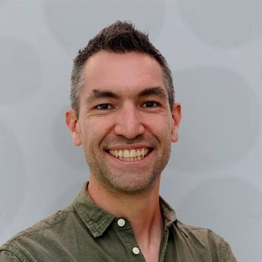
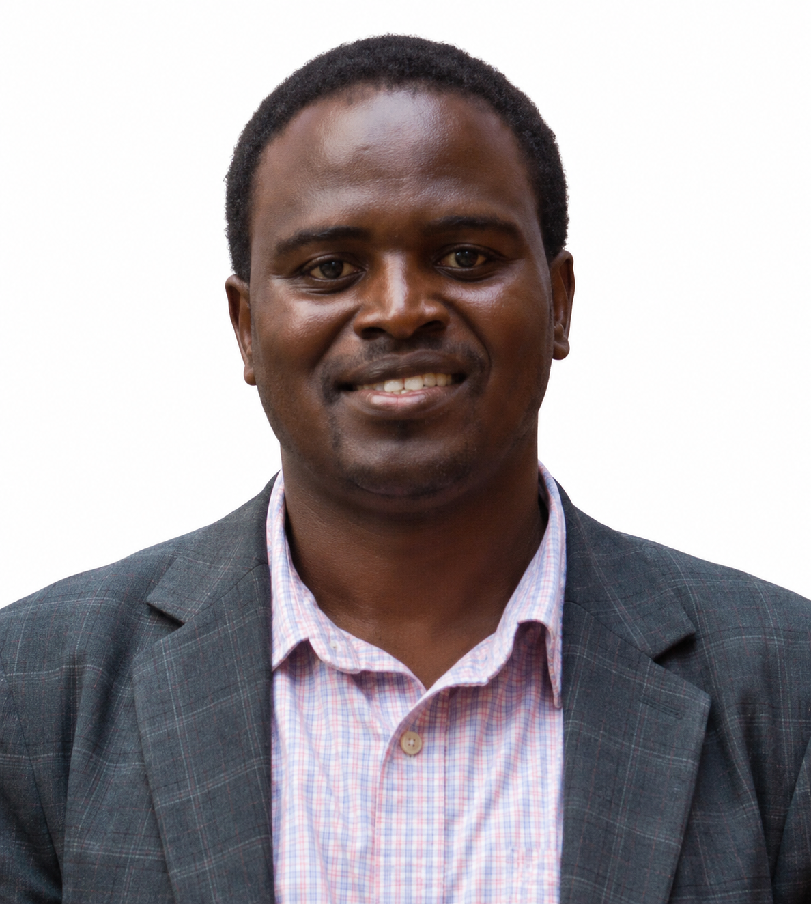
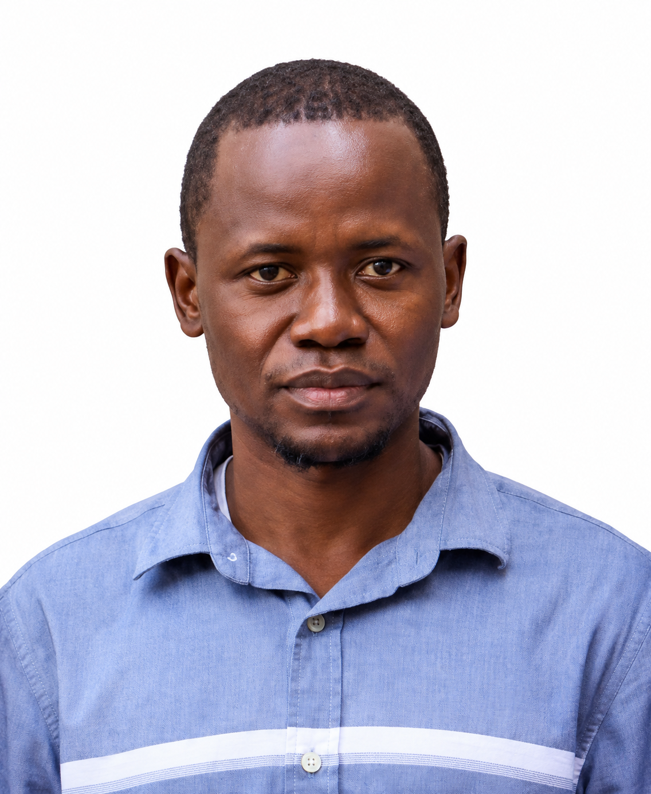

## Overview

::: {.intro}
The 2025 edition of the Geospatial Modelling Workshop ran 16–18
September 2025 at the University of Dar es Salaam (Mwalimu Julius
Kambarage Nyerere Campus), Tanzania. The course covered geostatistics
and geospatial modelling using the INLA approach.
:::

## Format

::: {.card-grid}
::: {.card}
<i class="bi bi-calendar-event card-icon" aria-hidden="true"></i>

**Dates**

16–18 September 2025.
:::

::: {.card}
<i class="bi bi-geo-alt card-icon" aria-hidden="true"></i>

**Location**

University of Dar es Salaam, Mwalimu Julius Kambarage Nyerere Campus,
Tanzania.
:::
:::

## Course Topic

Geostatistics and geospatial modelling with the INLA approach.

## Team

The people who taught, presented, facilitated and coordinated the
2025 edition of the Geospatial Modelling Workshop.

### Instructors

::: {.card-grid .team-grid}
::: {.card}
{.avatar-photo}

**[Dr. Susan Rumisha](https://www.thekids.org.au/contact-us/our-people/r/susan-rumisha/){target="_blank" rel="noopener noreferrer"}**

Lead of the MAP Dar es Salaam Node, Ifakara Health Institute.
:::

::: {.card}
{.avatar-photo}

**[Dr. Punam Amratia](https://www.thekids.org.au/contact-us/our-people/a/punam-amratia/){target="_blank" rel="noopener noreferrer"}**

Technical Lead, MAP Dar es Salaam Node, Ifakara Health Institute.
:::

::: {.card}
{.avatar-photo}

**[Dr. Amina Msengwa](https://www.nbs.go.tz/administration/management-team/statistician-general){target="_blank" rel="noopener noreferrer"}**

Statistician General, National Bureau of Statistics, Tanzania.
:::
:::

### Invited Speaker

::: {.card-grid .team-grid}
::: {.card}
{.avatar-photo}

**[Prof. Nick Golding](https://staffportal.curtin.edu.au/staff/profile/view/nick-golding-fea4f81a/){target="_blank" rel="noopener noreferrer"}**

Curtin School of Population Health, Curtin University.
Special Lecture: Understanding Generalized Linear Models.
:::
:::

### Facilitators

::: {.card-grid .team-grid}
::: {.card}
{.avatar-photo}

**[Dr. Aron Wiggins](https://tz.linkedin.com/in/wiggins-aaron-a5507491){target="_blank" rel="noopener noreferrer"}**

Lecturer, University of Dar es Salaam.
:::

::: {.card}
{.avatar-photo}

**[Mr. Bwire Wilson](https://www.linkedin.com/in/bwire-wilson-1789916b/){target="_blank" rel="noopener noreferrer"}**

University of Dar es Salaam.
:::
:::

### Coordinators

::: {.card-grid .team-grid}
::: {.card}
{.avatar-photo}

**[Sosthenes Ketende](https://www.ihi.or.tz/en/our-staff/239/Sosthenes/Charles%2520Ketende/details/){target="_blank" rel="noopener noreferrer"}**

Program Manager, MAP Dar es Salaam Node, Ifakara Health Institute.
:::

::: {.card}
{.avatar-photo}

**[Christine Myalla](https://www.linkedin.com/in/christinamyalla/){target="_blank" rel="noopener noreferrer"}**

Data Engineer Lead, MAP Dar es Salaam Node, Ifakara Health Institute.
:::
:::

## Organized By

This edition was organized by the Malaria Atlas Project (Dar es
Salaam Node, Ifakara Health Institute) and the Department of
Statistics, University of Dar es Salaam.

## Editions

See [other editions](index.qmd).
