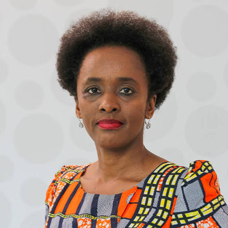
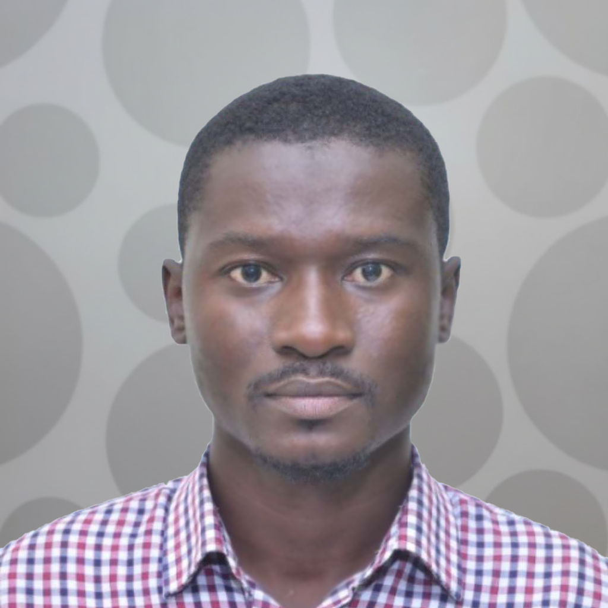
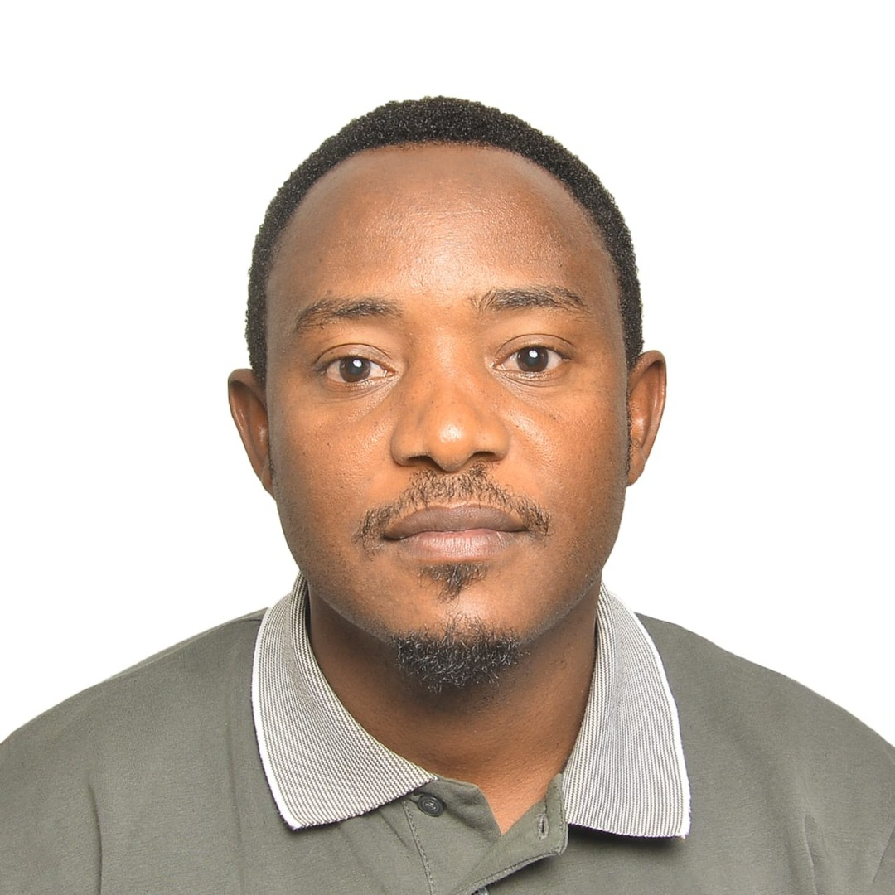
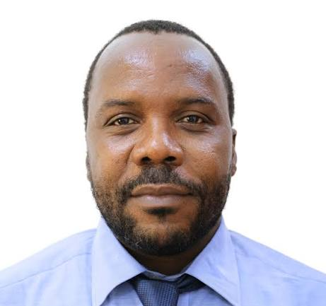
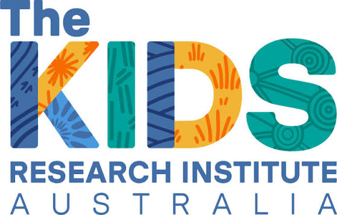
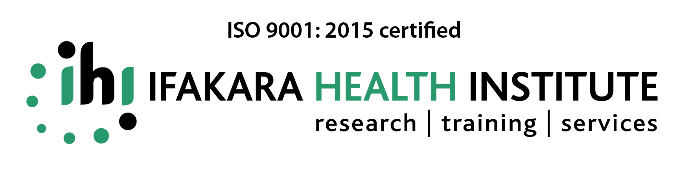
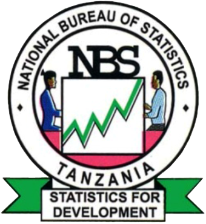

## Overview

::: {.intro}
The 2026 edition of the Geospatial Modelling Workshop runs 15–18
September 2026 at Takwimu House in Dodoma, Tanzania. This year's course
focuses on spatial and spatio-temporal modelling with INLAbru, building
on the core geostatistical methods taught in the programme.
:::

## Format

::: {.card-grid}
::: {.card}
<i class="bi bi-calendar-event card-icon" aria-hidden="true"></i>

**Dates**

15–18 September 2026 (4-day intensive workshop).
:::

::: {.card}
<i class="bi bi-clock card-icon" aria-hidden="true"></i>

**Daily Schedule**

All day, 9am–4pm.
:::

::: {.card}
<i class="bi bi-geo-alt card-icon" aria-hidden="true"></i>

**Location**

Takwimu House, Dodoma, Tanzania.
:::

::: {.card}
<i class="bi bi-hourglass-split card-icon" aria-hidden="true"></i>

**Application Deadline**

Applications close 30 August 2026.
:::
:::

## Course Topic & Seminars

- **Course topic:** Spatial and spatio-temporal modelling with INLAbru
- **Special seminar 1:** "The Data Behind the Decisions: National
  Statistical Offices as Partners in Public Health" — Dr. Amina Msengwa
- **Special seminar 2:** "Spatial Disaggregation in R" — Tim Lucas

## Team

The people teaching, presenting, facilitating and coordinating the
2026 edition of the Geospatial Modelling Workshop.

### Instructors

::: {.card-grid .team-grid}
::: {.card}
{.avatar-photo}

**[Dr. Susan Rumisha](https://www.thekids.org.au/contact-us/our-people/r/susan-rumisha/){target="_blank" rel="noopener noreferrer"}**

Lead of the MAP Dar es Salaam Node, Ifakara Health Institute.
:::

::: {.card}
{.avatar-photo}

**[Prof. Janine Illian](https://uk.linkedin.com/in/janineillian){target="_blank" rel="noopener noreferrer"}**

Chair in Statistical Sciences, University of Glasgow.
:::
:::

### Invited Speakers

::: {.card-grid .team-grid}
::: {.card}
{.avatar-photo}

**[Dr. Amina Msengwa](https://www.nbs.go.tz/administration/management-team/statistician-general){target="_blank" rel="noopener noreferrer"}**

Statistician General, National Bureau of Statistics, Tanzania.
Special seminar 1.
:::

::: {.card}
{.avatar-photo}

**[Dr. Tim Lucas](https://le.ac.uk/people/tim-lucas){target="_blank" rel="noopener noreferrer"}**

Lecturer in Biostatistics, University of Leicester.
Special seminar 2: "Spatial Disaggregation in R".
:::
:::

### Facilitators

::: {.card-grid .team-grid}
::: {.card}
{.avatar-photo}

**[Dr. Ousmane Diao](https://sn.linkedin.com/in/ousmane-diao-391b33100){target="_blank" rel="noopener noreferrer"}**

Senior Research Scientist, MAP Dar es Salaam Node, Ifakara Health Institute.
:::

::: {.card}
{.avatar-photo}

**[Dr. Lembris Njotto](https://www.linkedin.com/in/lembris-njotto-6238b482/){target="_blank" rel="noopener noreferrer"}**

Senior Research Scientist, MAP Dar es Salaam Node, Ifakara Health Institute.
:::

::: {.card}
{.avatar-photo}

**[Yasin Kokoda](https://www.linkedin.com/in/yasini-muhamedi-kokoda-984bb0247/){target="_blank" rel="noopener noreferrer"}**

Research Scientist, MAP Dar es Salaam Node, Ifakara Health Institute.
:::
:::

### Coordinators

::: {.card-grid .team-grid}
::: {.card}
{.avatar-photo}

**[Dr. Punam Amratia](https://www.thekids.org.au/contact-us/our-people/a/punam-amratia/){target="_blank" rel="noopener noreferrer"}**

Technical Lead, MAP Dar es Salaam Node, Ifakara Health Institute.
:::

::: {.card}
{.avatar-photo}

**[Sosthenes Ketende](https://www.ihi.or.tz/en/our-staff/239/Sosthenes/Charles%2520Ketende/details/){target="_blank" rel="noopener noreferrer"}**

Program Manager, MAP Dar es Salaam Node, Ifakara Health Institute.
:::

::: {.card}
{.avatar-photo}

**[Christine Myalla](https://www.linkedin.com/in/christinamyalla/){target="_blank" rel="noopener noreferrer"}**

Data Engineer Lead, MAP Dar es Salaam Node, Ifakara Health Institute.
:::
:::

## In Partnership With {.partner-strip}

{.padded-logo}

## Registration

Ready to apply? Review the eligibility criteria and application
details on the Call for Applications page.

[Apply Now →](../apply/index.qmd){.btn}

Curious what other cohorts covered? See [past editions](index.qmd).
